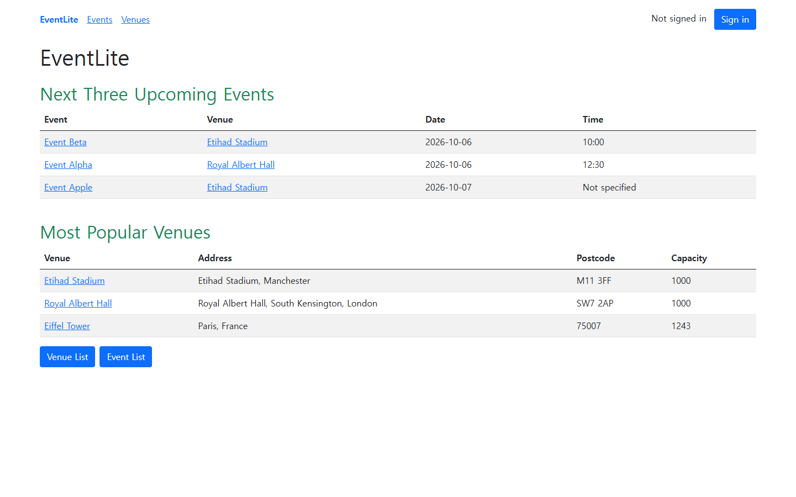
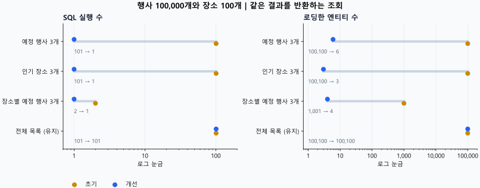

[English](README.md) | [한국어](README.ko.md)

# 행사 및 장소 관리 웹 서비스(EventLite)

EventLite는 행사와 장소를 등록하고 검색하며, 일정을 조회하고 관리자 폼에서 정보를 관리하는 Spring Boot 팀 프로젝트입니다. 맨체스터대학교 COMP23412 Software Engineering 수업에서 제공한 기본 코드를 바탕으로 **2025년 2월부터 5월까지** 개발했습니다.

**박동명은 테스트 케이스 작성, 보안 구현, 행사와 장소 관리 등 주요 기본 기능에 참여했습니다. 최초 지도 연결은 다른 팀원이 담당했습니다.** 전체 서비스는 팀의 결과이며, 이 문서에서 설명하는 이후의 유지보수와 검증은 원래 과제와 구분합니다.

[GitHub 저장소](https://github.com/Dongmyung378/Event-Website) | [포트폴리오 소개](https://park-dongmyung.com/projects/project-10/) | [개인 기여와 결과](docs/PORTFOLIO.ko.md) | [구조와 코드 안내](docs/ARCHITECTURE.ko.md)



실행 화면은 애플리케이션의 원래 영어 UI를 그대로 캡처한 것입니다.

## 프로젝트에서 보여주는 역량

현재 버전은 행사와 장소의 CRUD, 검색, 일정 화면, 지도, 관리자 기능, 읽기 전용 HAL JSON API를 유지합니다. 이번 개선에서는 데이터 증가, 동시 수정, 외부 서비스 장애, DB 복구에 대응하는 방식을 보강했습니다.

| 영역 | 현재 구현 |
| --- | --- |
| 조회 | DB에서 최대 3개를 선택하는 다음 행사 조회와 인기 장소 집계, 선택형 DB 페이지 처리 |
| 일정 일관성 | 공통 `Clock`, 날짜와 시간, 이름 대소문자 무시, ID 순서에 따른 결정적 정렬 |
| 동시 변경 | 트랜잭션 단위 변경, 폼 원본 버전 전송, 낙관적 잠금, HTTP 409 충돌 안내 |
| 데이터 관계 | 행사 등록이나 장소 변경과 장소 삭제에 같은 장소 행 잠금을 적용하고 외래 키 유지 |
| 외부 피드 | 30초 동안 캐시 사용, 성공 결과를 최대 300초까지 재사용, 갱신 중복 방지, 실패 후 10초 재시도 대기 |
| 복구 | 파일 DB 재시작 검증, SHA-256 무결성 확인, 새 경로로 복원하는 오프라인 스냅샷 |
| 재현 | Maven Wrapper, Java와 JavaScript 테스트, 브라우저 검증 스크립트, Windows와 Linux CI 구성 |

실행 기반은 **Java 17과 Spring Boot 4.0.8**입니다. 기존 JSON 직렬화 결과를 유지하기 위해 폐기 예정인 `spring-boot-jackson2` 호환 모듈을 사용합니다. Boot 4로 실행 기반을 옮긴 결과이며, Jackson 3로의 전면 전환까지 완료한 것은 아닙니다.

## 데모 실행

JDK 17과 최초 Maven 다운로드를 위한 인터넷 연결이 필요합니다. Maven Wrapper가 포함되어 있습니다. JavaScript와 브라우저 검증에는 Node.js 22.4 이상과 Chrome 또는 Chromium도 필요합니다.

Windows PowerShell:

```powershell
$env:JAVA_HOME = '설치한 JDK 17 경로'
.\mvnw.cmd spring-boot:run '-Dspring-boot.run.profiles=demo'
```

macOS / Linux:

```bash
sh ./mvnw spring-boot:run -Dspring-boot.run.profiles=demo
```

`http://localhost:8080/home`으로 접속합니다. 공개 데모 계정은 `demo-admin` / `demo-password`이며, `demo` 프로필을 명시적으로 활성화했을 때만 생성됩니다. 기본 데모 DB는 종료하면 사라지는 메모리 DB입니다. 외부 서비스는 기본적으로 비활성화되며, 위 명령은 기존 파일 DB를 열지 않습니다.

일반 프로필은 파일 DB를 사용하고 기본 관리자 계정을 생성하지 않습니다. 관리 기능을 사용하려면 `EVENTLITE_ADMIN_USERNAME`, `EVENTLITE_ADMIN_PASSWORD`를 지정하십시오. `.env.example`은 설정 예시이며 자동으로 읽히지 않습니다. DB와 선택적 외부 연동 설정은 [환경 설정 안내](docs/ARCHITECTURE.ko.md#환경-설정)에서 확인할 수 있습니다.

## 기존 조회와 페이지 처리

페이지 관련 인자가 없으면 HTML 전체 목록과 HAL 컬렉션의 기존 응답을 유지합니다. 데이터가 많을 때는 **View 20 per page** 링크를 선택하거나 `page`, `size`를 지정할 수 있습니다.

```text
/events?page=0&size=20
/events/search?q=music&page=0&size=20
/venues?page=0&size=20
/api/events?page=0&size=20&q=music
/api/venues?page=0&size=20
```

페이지 번호는 0부터 시작하고, 크기를 생략하면 20개를 사용합니다. 페이지 크기는 1부터 100까지 허용하며 범위를 벗어나면 400을 반환합니다. API 요청에는 `Accept: application/json` 또는 `application/hal+json`을 지정하십시오. 페이지형 HAL 응답에는 페이지 정보와 이동 링크가 추가됩니다. API의 쓰기 요청은 관리자에게도 허용하지 않습니다.

## 검증과 측정 결과

[2026-10-05 검증 기록](docs/verification.json)은 Java 212개, JavaScript 10개 통과와 Java 줄 커버리지 95.24%, 분기 커버리지 72.68%를 담은 이전 기록으로 보존합니다. 아래 수치는 이후 강화 작업의 결과이며 2025년 과제 당시의 성과로 소급하지 않습니다.

| 검증 | 현재 기록 |
| --- | --- |
| Windows Java 테스트 | 276개 통과, 실패와 오류 및 건너뜀 0개 |
| JavaScript 테스트 | 15개 통과 |
| Java 선 / 분기 커버리지 | 95.31% / 76.32% |
| 커버리지 통과 기준 | Maven `verify`에서 줄 90% 이상, 분기 70% 이상 |
| 별도 Linux Java 실행 | 276개 통과, 실패와 오류 및 건너뜀 0개 |
| 브라우저와 DB 복구 검증 | 22개 통과, 실패 0개 |

행사 100,000개와 장소 100개 조건에서 다음 행사 3개 조회와 인기 장소 조회의 SQL 실행 수는 각각 **101회에서 1회로 감소**했습니다. 로드한 엔티티는 다음 행사 조회에서 **100,100개에서 6개**, 인기 장소 조회에서 **100,100개에서 3개**로 줄었습니다. 비교한 12개 조회 조건의 결과 SHA-256은 모두 일치했습니다.

이 수치는 워밍업 후 반복 측정한 H2 서비스 조회 결과입니다. HTTP 응답 시간, 운영 처리량, 브라우저 로딩 시간을 의미하지 않습니다. 인자가 없는 전체 목록은 같은 조건에서 SQL 101회를 유지합니다. 데이터가 적은 장소별 다음 행사 조회에서는 시간이 소폭 늘어난 조건도 있어 원시 측정값을 함께 보존합니다.

[조회 비교](docs/reports/query-comparison.json), [초기 측정값](docs/reports/initial-query-benchmark.json), [현재 측정값](docs/reports/final-query-benchmark.json), [현재 검증 기록](docs/reports/verification.json)을 확인할 수 있습니다. GitHub Actions 설정은 별도로 제공하며, 로컬 결과를 CI 실행 결과로 소개하지 않습니다.



전체 목록 경로는 조회 구조를 유지했습니다. 행사 10만 개의 중앙값은 204.146 → 203.760ms, p95는 231.944 → 237.591ms였습니다. 1만 개 조건 등 오히려 느려진 결과도 있으며 이 경로를 최적화했다고 주장하지 않습니다.

## 검증 재현

Windows PowerShell:

```powershell
.\mvnw.cmd verify
node --test src/test/javascript/event-maps.test.cjs src/test/javascript/database-snapshot.test.mjs
node scripts/verify-browser.mjs --output target/browser-verification
node scripts/query-benchmark.mjs target/benchmark/queries.json current 1000,10000,100000
node scripts/timeline-benchmark.mjs target/benchmark/timeline.json current 150
```

macOS / Linux에서는 첫 명령을 `sh ./mvnw verify`로 바꾸고 Node 명령은 동일하게 사용합니다. 브라우저 검증 전에 실행 가능한 JAR를 빌드해야 합니다. Chrome을 찾지 못하면 `CHROME_PATH`를 지정하십시오. 브라우저 실행마다 별도 임시 파일 DB와 고유한 결과 폴더를 만들며, 실제 Mastodon과 Mapbox 자격 증명은 비활성화합니다.

브라우저 스크립트는 공개 조회와 관리자 작업, 두 탭의 수정 충돌, 정렬, 선택형 페이지 처리, 모바일 화면, 재시작, 오프라인 백업과 복원을 확인합니다. 앱 상태와 데모 초기화를 기다린 뒤 검증을 시작하며, 백업 전에는 명시적으로 활성화한 로컬 SpringApplication JMX 관리 빈으로 정상 종료를 요청하고 프로세스 종료를 확인합니다. 실제 초기 버전 파일 DB의 업그레이드를 확인하려면 `--seed-jar <초기-버전-실행-JAR>`를 지정합니다.

동일한 조회 스크립트로 다른 체크아웃을 비교하려면 `EVENTLITE_BENCHMARK_PROJECT`에 해당 경로를 지정합니다. 비교 기준 초기 리비전은 `a18ca3d`입니다. 자세한 범위는 [비교 재현 안내](docs/PORTFOLIO.ko.md#비교-재현)를 확인하십시오.

차트만 다시 생성하려면 Python과 matplotlib을 설치하고 `python scripts/render-results.py ko`를 실행합니다. 한국어판은 `docs/images/query-cost.ko.svg`에 저장하며, `python scripts/render-results.py en`은 별도의 영어판 `docs/images/query-cost.svg`를 생성합니다. 두 언어는 같은 보존된 조회 보고서를 사용하고, SVG 글자는 보는 환경의 글꼴에 영향을 받지 않도록 경로로 저장합니다. 앱 실행이나 검증에는 Python이 필요하지 않습니다.

한국어판을 다시 생성하려면 한국어 글꼴도 설치돼 있어야 합니다. 생성기는 Malgun Gothic, Noto Sans CJK KR, Noto Sans KR, Apple SD Gothic Neo, NanumGothic 순서로 사용 가능한 글꼴을 선택하며, 하나도 없으면 명확한 오류와 함께 중단합니다. 저장된 SVG를 볼 때는 이 글꼴이 필요하지 않습니다.

## DB 스냅샷

DB를 사용하는 모든 앱 프로세스를 종료한 후 오프라인 작업을 확인해야 합니다. H2 경로는 `.mv.db` 확장자를 제외한 기본 경로로 지정합니다.

```text
node scripts/database-snapshot.mjs backup db/eventlite-dev target/snapshots/new-snapshot --offline-confirmed
node scripts/database-snapshot.mjs restore target/snapshots/new-snapshot db/restored-eventlite --offline-confirmed
```

백업은 이미 있는 스냅샷 폴더를 덮어쓰지 않습니다. 복원은 매니페스트와 체크섬을 검증하며 기존 DB를 덮어쓰지 않습니다. 복원한 DB를 실행하려면 `EVENTLITE_DATASOURCE_URL`을 새 기본 경로로 지정하고 원래 DB 인증 설정을 유지해야 합니다. 검증 범위는 오프라인 H2 복구이며, 온라인 백업이나 운영 DB의 복구 보장을 의미하지 않습니다.

## 공개 범위와 출처

소스 ZIP에는 DB 파일, 자격 증명, Git 메타데이터, 개인 실행 일지를 포함하지 않습니다. 자동 검증은 통제된 데이터와 가짜 외부 응답을 사용했습니다. 실제 Mapbox와 Mastodon 계정의 동작, 운영 트래픽은 해당 환경에서 별도로 검증해야 합니다. Jackson 3 전환, 운영 DB 관리, TLS, 관리자 계정의 생성과 폐기는 별도 운영 과제입니다.

기본 코드 출처는 University of Manchester의 COMP23412 EventLite이며 제공자는 Robert Haines, Markel Vigo, Mustafa Mustafa, Tom Carroll, Caroline Jay입니다. 원래 저작권과 BSD 라이선스를 [LICENSE](LICENSE)에 유지합니다.
