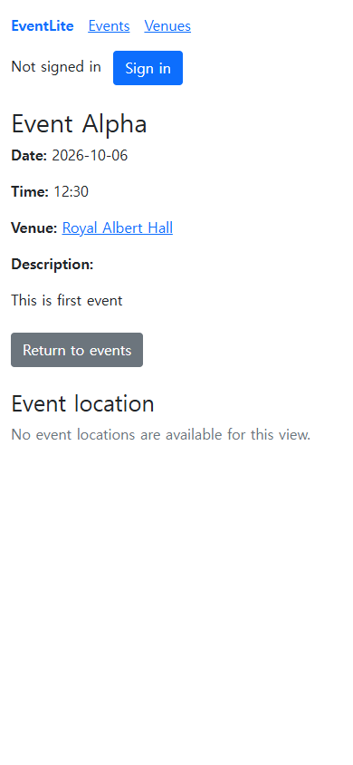

[English](README.md) | [한국어](README.ko.md)

# EventLite — Event and Venue Management

EventLite is a **Spring Boot team project** for registering and searching events and venues, and browsing venue schedules. It was developed during **February–May 2025** for **COMP23412 Software Engineering** at the University of Manchester, building on the supplied EventLite starter code.

[GitHub repository](https://github.com/Dongmyung378/Event-Website) · [Project on my portfolio](https://park-dongmyung.com/projects/project-10/)

**Dongmyung Park contributed test cases, security implementation, and core functionality other than map integration.** His work included event and venue management and their verification. Map integration was handled by another team member.

| Category | Details |
| --- | --- |
| Original project | February–May 2025, university team assignment |
| Individual contribution | Test cases · security · core features including event and venue management |
| Current repository | The team project and subsequent maintenance changes |
| Maintenance verification | 2026-10-05: 212 Java tests and 10 JavaScript tests passed |

The verification figures and fixes below describe the **maintenance version verified on 2026-10-05**. They are separate from the original 2025 assignment results, and the complete service is a team result.


[Project process and individual contribution — Korean](docs/PORTFOLIO.md) · [Architecture and source guide — Korean](docs/ARCHITECTURE.md) · [Verification record](docs/verification.json)

## Features

- Event and venue lists, details, creation, updates, deletion, and search by name
- Upcoming and past events, venue-specific events, and the next three events at a venue
- Login and access control for management features through the `ADMINISTRATOR` role
- HTML pages and an explicitly read-only HAL JSON API
- Venue geocoding and map display using a configured Mapbox account
- Public posts from a configured Mastodon account and posting by administrators
- A local demo with an in-memory database that runs without external API keys

## Technology

Java 17 · Spring Boot · Spring MVC · Spring Security · Spring Data JPA · Thymeleaf · H2 · Bootstrap · JUnit 5 · Mockito · MockMvc · WebTestClient · JaCoCo

The MVC pages and read-only HAL API share the same services and JPA repositories. Creation, updates, and deletion go through HTML management flows protected by administrator authorization and CSRF checks. Package responsibilities and design decisions are described in the [architecture document — Korean](docs/ARCHITECTURE.md).

## Run locally

Requirements: **JDK 17** and an internet connection for the initial dependency download. Maven Wrapper is included, so a separate Maven installation is not required. The JavaScript regression tests use **Node.js 22 or later**.

Windows PowerShell:

```powershell
$env:JAVA_HOME = 'Path to your JDK 17 installation'
.\mvnw.cmd spring-boot:run '-Dspring-boot.run.profiles=demo'
```

macOS / Linux:

```bash
sh ./mvnw spring-boot:run -Dspring-boot.run.profiles=demo
```

Open `http://localhost:8080/home`. The demo credentials are `demo-admin` / `demo-password`. This account is created **only when the `demo` profile is explicitly enabled**. The demo uses a separate in-memory database that is discarded on shutdown and does not change existing files under `db/`. External services are disabled by default in the demo.

The normal profile has no default administrator account. Set the `EVENTLITE_ADMIN_USERNAME` and `EVENTLITE_ADMIN_PASSWORD` environment variables to use management features. Passwords are encoded with BCrypt for authentication. To open an existing file database, set the environment variables for that database's username and password.

`.env.example` documents the settings and is not loaded automatically. See the [environment configuration guide — Korean](docs/ARCHITECTURE.md#환경-설정) for database, authentication, external service, and Mapbox settings. The local demo's core browsing and management features work without external service accounts.

## Maintenance verification — 2026-10-05

```powershell
.\mvnw.cmd verify
node --test src/test/javascript/event-maps.test.cjs
```

On macOS / Linux, use `sh ./mvnw verify`. Tests use the `test` profile's in-memory database and dedicated test authentication settings.

| Check | Result |
| --- | --- |
| Java tests | 212 passed; 0 failures, errors, or skipped tests |
| JavaScript tests | 10 passed; 0 failures |
| JaCoCo Java line coverage | 95.24% |
| JaCoCo Java branch coverage | 72.68% |
| Browser | Login and event creation → update with the same ID → deletion; 0 JavaScript errors |
| Layout | Desktop at 1440px and mobile at 390px; no horizontal overflow |

Tests used a separate in-memory database and simulated external responses. No real external account APIs were called. Detailed Java results are generated under `target/surefire-reports/`, and coverage is generated at `target/site/jacoco/index.html`. The [verification and retrospective — Korean](docs/PORTFOLIO.md#유지보수-검증) describes the scope and limitations; the recorded results are in [verification.json](docs/verification.json).

GitHub Actions configuration is included. The figures above are from local execution and are separate from GitHub CI results.

## Screenshots



## Improvements after the team assignment

Maintenance fixes addressed missing authorization checks, small venue datasets, date boundaries, HTML insertion in map popups, stale coordinates after address changes, and incorrect reporting of failed external posts. Regression tests were added. The conditions and results are documented in the [project retrospective — Korean](docs/PORTFOLIO.md#유지보수에서-개선한-조건).

## Publication scope and remaining operational work

This repository is portfolio material covering the team assignment and subsequent maintenance. Real posting and map responses must be checked separately in an environment configured with the relevant credentials. Tokens from earlier source versions must be revoked or rotated through their service providers; removing them from current source does not remove them from existing Git history. The source distribution prepared for publication excludes previous Git history, database files, and personal environment files.

A public deployment also needs TLS, a production database and backups, administrator account lifecycle management, traffic limits, and dependency updates appropriate to its operating environment.

## Attribution and license

Starter code: COMP23412 EventLite, University of Manchester. This project builds on the starter project provided by Robert Haines, Markel Vigo, Mustafa Mustafa, Tom Carroll, and Caroline Jay. The original copyright and BSD license are retained; see the [original license](LICENSE). The supplied course code is credited to its original authors.
