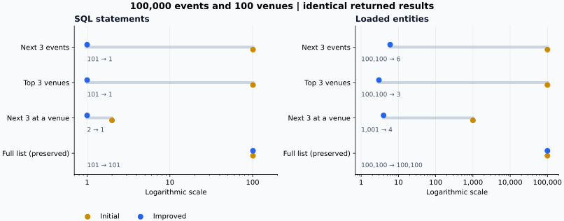

[English](README.md) | [한국어](README.ko.md)

# EventLite — Event and Venue Management

EventLite is a Spring Boot team project for registering and searching events and venues, browsing schedules, and managing records through authenticated web forms. The original project ran from **February to May 2025**, using the supplied COMP23412 Software Engineering starter code at the University of Manchester.

**Dongmyung Park contributed test cases, security implementation, and core management features. The initial map integration was another team member's contribution.** The complete application is a team result. The later maintenance and verification described here are separate from the original assignment.

[GitHub repository](https://github.com/Dongmyung378/Event-Website) | [Portfolio project](https://park-dongmyung.com/projects/project-10/) | [Individual contribution and results](docs/PORTFOLIO.md) | [Architecture and source guide](docs/ARCHITECTURE.md)


## Understand the application

A visitor searches for an event, checks its date and venue, and browses upcoming events. An administrator signs in to create or edit those records. The input is an event or venue form, or a search request; the output is a saved record, a schedule page, or a structured response for another program. Spring Boot handles the web requests, while the H2 database stores the records.

**CRUD** means creating, reading, updating and deleting records. The **API** is the interface other programs can call; its read-only **HAL JSON** responses contain data and links to related resources. Browser users can use the normal pages without knowing that format.

The engineering question is how to preserve these familiar operations when the database grows or a request fails. For example, displaying the next few events should not require loading every event, and an old edit form should not overwrite a newer change without warning.

## What the project demonstrates

The current version preserves the original event and venue CRUD, searches, schedule pages, maps, administrator controls, and read-only HAL JSON API. Maintenance strengthens how those features handle larger datasets, simultaneous edits, external service failures, and database recovery.

An **optimistic lock** checks whether a record changed after a form was opened; a conflict asks the user to reload it. A **transaction** keeps a related set of database changes together. A **cache** reuses a recent external response, and **backoff** waits before retrying a failed request. These mechanisms address different failure cases rather than adding new user-facing features.

| Area | Current implementation |
| --- | --- |
| Queries | Database-limited next-three queries and popular-venue aggregation; optional database pagination |
| Schedule consistency | Shared `Clock` and deterministic date, time, case-insensitive name, and ID ordering |
| Concurrent changes | Transactional mutations, original-version form fields, optimistic locking, and HTTP 409 conflict feedback |
| Relationships | Shared venue-row locks for event insertion or reassignment and venue deletion; foreign key retained |
| External feed | 30-second fresh cache, recent successful results for up to 300 seconds, one refresh, and 10-second failure backoff |
| Recovery | File database restart checks and offline snapshots with SHA-256 validation and restore to a new path |
| Reproduction | Maven Wrapper, Java and JavaScript tests, browser verification script, and a Windows/Linux CI matrix |

The runtime uses **Java 17 and Spring Boot 4.0.8**. The deprecated `spring-boot-jackson2` compatibility module preserves existing JSON serialization while moving the application to Boot 4. This is a temporary Jackson 2 bridge; a complete Jackson 3 migration is outside the current result.

## Run the demo

Requirements: JDK 17 and internet access for the first Maven download. Maven Wrapper is included. The JavaScript and browser checks additionally require Node.js 22.4 or later and Chrome or Chromium.

Windows PowerShell:

```powershell
$env:JAVA_HOME = 'Path to your JDK 17 installation'
.\mvnw.cmd spring-boot:run '-Dspring-boot.run.profiles=demo'
```

macOS / Linux:

```bash
sh ./mvnw spring-boot:run -Dspring-boot.run.profiles=demo
```

Open `http://localhost:8080/home`. The public demo account is `demo-admin` / `demo-password`, created only when the `demo` profile is explicitly enabled. Its default in-memory database is discarded on shutdown. External services are disabled by default, and no existing file database is opened by the demo command above.

The normal profile uses a file database and creates no default administrator. Set `EVENTLITE_ADMIN_USERNAME` and `EVENTLITE_ADMIN_PASSWORD` to enable management. `.env.example` lists settings but is not loaded automatically. See [environment configuration](docs/ARCHITECTURE.md#environment-configuration) for database and optional integration settings.

## Query compatibility and pagination

Requests without pagination parameters retain their existing full-list HTML and HAL collection responses. For larger datasets, choose the **View 20 per page** link or supply `page` and `size`:

```text
/events?page=0&size=20
/events/search?q=music&page=0&size=20
/venues?page=0&size=20
/api/events?page=0&size=20&q=music
/api/venues?page=0&size=20
```

Pages start at zero, default to 20 records when the size is omitted, and accept sizes from 1 to 100. Invalid bounds return 400. API clients should request `Accept: application/json` or `application/hal+json`. Paged HAL responses add page metadata and navigation links. The original API remains read-only, including for administrators.

## Verification and measured results

The figures below answer two separate questions: do the checked behaviors work, and how much database work do selected queries perform? A passing test checks a specific expected behavior. **Line coverage** counts executable lines reached by tests; **branch coverage** counts exercised alternatives such as the true and false sides of a condition. Neither percentage is the probability that the application is error-free.

A **SQL statement** is a request sent to the database. A **loaded entity** is a database-backed Java object brought into application memory, including related records. Reducing these counts means less database and object-loading work for the measured operation. A matching **SHA-256** result signature checks that the compared output stayed identical. **p95** is a high-end timing summary: about 95% of measured durations are at or below it, whereas the median describes the middle observation.

The [2026-10-05 record](docs/verification.json) is retained as historical evidence: 212 Java tests, 10 JavaScript tests, 95.24% Java line coverage, and 72.68% branch coverage. The following figures describe the subsequent strengthening work, not the 2025 assignment.

| Check | Local Windows result, 2026-10-19 |
| --- | --- |
| Windows Java tests | 278 passed; 0 failures, errors, or skipped tests |
| JavaScript map and snapshot tests | 15 passed |
| Browser launcher regressions | 2 passed |
| Java line / branch coverage | 95.31% / 76.32% |
| Coverage gate | At least 90% line and 70% branch coverage during Maven `verify` |
| Browser and database recovery verification | 22 passed; 0 failures |

Two new regressions verify H2 database isolation between Spring contexts: opening another context preserves existing rows, and closing it preserves the other context's schema and rows. The `test` profile now assigns each context its own memory database.

The [2026-10-19 local record](docs/reports/ci-repair-verification.json) contains the JDK 17 results above, including the browser run with a retained legacy JAR. The [2026-10-15 record](docs/reports/verification.json) preserves the earlier Windows/Linux 276-test results. GitHub Actions runs the 21 common browser checks with a fresh database; the optional `--seed-jar` argument adds the legacy database upgrade check.

For 100,000 events and 100 venues, the next-three and popular-venue operations each reduced SQL statements from **101 to 1**. Loaded entities decreased from **100,100 to 6** for the next-three event query and from **100,100 to 3** for popular venues. All 12 compared query conditions retained identical result SHA-256 values.

These are controlled H2 service-query measurements, using warmups and repeated samples. They are not HTTP response times, production throughput, or browser loading times. The no-parameter full-list operation remains unchanged and still issued 101 statements in the same fixture. Some small-data venue-next-three timings were slightly slower; all raw samples are retained.

See [query comparison](docs/reports/query-comparison.json), [initial measurements](docs/reports/initial-query-benchmark.json), [current measurements](docs/reports/final-query-benchmark.json), and the [2026-10-15 verification record](docs/reports/verification.json). GitHub Actions is configured separately; local results are not presented as completed CI runs.



The full-list path retains its original query structure. At 100,000 events its median was 204.146 → 203.760 ms and p95 was 231.944 → 237.591 ms. Some conditions, including 10,000 events, were slower; this compatibility path is not presented as optimized.

## Reproduce the checks

Windows PowerShell:

```powershell
.\mvnw.cmd verify
node --test src/test/javascript/event-maps.test.cjs src/test/javascript/database-snapshot.test.mjs
node --test scripts/lib/browser.test.mjs
node scripts/verify-browser.mjs --output target/browser-verification
node scripts/query-benchmark.mjs target/benchmark/queries.json current 1000,10000,100000
node scripts/timeline-benchmark.mjs target/benchmark/timeline.json current 150
```

On macOS / Linux, replace the first command with `sh ./mvnw verify`; the Node commands are the same. Build the executable JAR before running the browser script. Set `CHROME_PATH` if Chrome is not detected. Each browser run creates a separate temporary file database and a unique report directory. Real Mastodon and Mapbox credentials are disabled during verification.

The browser script checks public and administrator flows, two-tab stale edits, ordering, optional pagination, mobile rendering, restart, offline backup, and restored data. It waits for application health and demo initialization, then requests graceful shutdown through the explicitly enabled local SpringApplication JMX bean before copying the database. To check an actual initial-version file database upgrade, pass `--seed-jar <initial-version-executable.jar>`.

The launcher also records `chrome-launch.json` and `chrome-stderr.log` in the run folder. Startup errors report the executable, exit status and captured stderr. Ubuntu CI retains a diagnostic launch of the downloaded Chrome and uses the runner-installed Google Chrome for functional checks, with browser sandboxing enabled. The [separate launcher record](docs/reports/browser-launch-verification.json) covers the two launcher regressions and the 21 fresh-database browser checks after this helper change; the earlier verification record retains its original source hashes and counts.

To compare another checkout with the same query harness, set `EVENTLITE_BENCHMARK_PROJECT` to that checkout before invoking the scripts. The initial comparison revision is `a18ca3d`. [The portfolio document](docs/PORTFOLIO.md#reproduce-the-comparison) explains the comparison scope.

Optional chart regeneration: install Python and matplotlib, then run `python scripts/render-results.py en` for `docs/images/query-cost.svg` or `python scripts/render-results.py ko` for `docs/images/query-cost.ko.svg`. Both use the same retained query report and write separate language files. SVG labels are exported as paths so viewing does not depend on installed fonts. Python is not required to run or verify the application.

Korean regeneration also requires an installed Korean font. The generator tries Malgun Gothic, Noto Sans CJK KR, Noto Sans KR, Apple SD Gothic Neo, and NanumGothic in that order, and stops with a clear error if none is available. These fonts are not needed to view the saved SVGs.

## Database snapshots

Stop every application process using the database before confirming an offline snapshot. Supply the H2 base path without `.mv.db`:

```text
node scripts/database-snapshot.mjs backup db/eventlite-dev target/snapshots/new-snapshot --offline-confirmed
node scripts/database-snapshot.mjs restore target/snapshots/new-snapshot db/restored-eventlite --offline-confirmed
```

Backup refuses an existing snapshot directory. Restore validates the manifest and checksum and refuses to overwrite an existing database. Point `EVENTLITE_DATASOURCE_URL` at the restored base path and retain the original database authentication settings. This is verified offline H2 recovery, not online backup or a production database recovery guarantee.

## Scope and attribution

The source archive excludes database files, credentials, Git metadata, and personal run logs. Current automated checks use controlled fixtures and simulated external responses. Live Mapbox and Mastodon account behavior and production traffic need their own environment-specific verification. Jackson 3 migration, production database operation, TLS, and administrator account lifecycle management remain separate operating concerns.

Starter code: COMP23412 EventLite, University of Manchester, provided by Robert Haines, Markel Vigo, Mustafa Mustafa, Tom Carroll, and Caroline Jay. The original copyright and BSD license are retained in [LICENSE](LICENSE).
