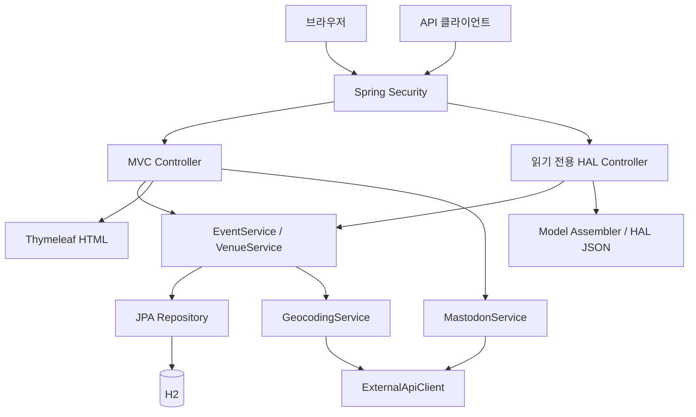

[English](ARCHITECTURE.md) | [한국어](ARCHITECTURE.ko.md)

# EventLite — 구조와 소스 코드 안내

이 문서는 현재 유지보수 버전의 구조를 설명합니다. 프로젝트 기간과 개인 기여는 [포트폴리오 문서](PORTFOLIO.ko.md), 실행 명령과 검증 결과 요약은 [한국어 README](../README.ko.md)에 있습니다.

## 요청과 데이터 흐름

공개 조회 요청과 관리자 변경 요청을 보안 필터에서 구분합니다. HTML 화면과 JSON API는 같은 행사·장소 서비스를 사용하되 응답 형식은 각 컨트롤러가 맡습니다. 외부 지도·소셜 요청에는 별도 HTTP 어댑터를 사용합니다.

## 소스 폴더 안내

Java 패키지의 기준 경로는 `src/main/java/uk/ac/man/cs/eventlite/`입니다.

| 위치 | 역할과 먼저 읽을 파일 |
| --- | --- |
| `entities/` | `Event.java`, `Venue.java`: 행사·장소 필드, 입력 제약과 JPA 관계 |
| `controllers/` | `EventsController`, `VenuesController`, `HomeController`: HTML 조회·폼 처리 |
| `controllers/*ControllerApi` | 행사·장소의 공개 조회와 HAL 응답 |
| `controllers/ApiController.java` | `/api` 조회 진입점 |
| `dao/` | 행사·장소 서비스와 JPA 저장소. 소셜 어댑터 `MastodonService`도 이 패키지에 위치 |
| `assemblers/` | 엔티티에 조회 링크를 추가하는 HAL 모델 구성 |
| `config/Security.java` | 공개 경로, 관리자 역할, CSRF, 인증·로그아웃 설정 |
| `config/IntegrationViewConfig.java` | 지도 공개 토큰, 연동 가능 여부, 공통 날짜 모델 |
| `config/data/InitialDataLoader.java` | `demo` 프로필의 초기 데이터 생성 |
| `services/` | `GeocodingService`, `Coordinates`, 제한 시간 적용 HTTP 클라이언트 |
| `src/main/resources/templates/` | 공통 레이아웃, 행사·장소·로그인 화면 |
| `src/main/resources/static/js/event-maps.js` | 지도 표시 조건, 좌표 검증과 팝업 생성 |
| `src/main/resources/application*.properties` | 일반·데모 환경 설정 |
| `src/test/java/` | 서비스·MVC·API·보안·외부 어댑터 테스트와 테스트 DB 구성 |
| `src/test/javascript/event-maps.test.cjs` | 지도 로직의 JavaScript 회귀 테스트 |
| `docs/images/`, `docs/verification.json` | 유지보수 검증 당시 화면과 결과 기록 |

## 데이터 모델과 일정 규칙

하나의 행사는 하나의 장소에 연결되고, 한 장소에는 여러 행사가 연결됩니다. 행사에는 이름, 날짜, 선택적인 시간과 설명이 있습니다. 장소는 이름, 수용 인원, 도로 주소, 우편번호, 선택적인 위도·경도를 저장합니다.

신규 등록과 수정 폼은 필수값·길이·날짜를 검증합니다. 행사에 선택한 장소가 실제로 존재하는지도 확인하며 DB의 행사 장소 외래키는 null을 허용하지 않습니다. 연결된 행사가 남아 있는 장소의 삭제 요청은 안내 메시지와 함께 거절합니다.

폼의 행사 날짜는 미래 날짜를 요구합니다. 이미 저장된 행사가 당일이 됐을 때는 예정 행사에 포함하므로 예정 목록의 기준은 **오늘 이후가 아니라 오늘을 포함한 날짜**입니다. 다음 3개 행사는 날짜·시간·이름 순서로 정렬하며 시간이 없는 행사는 같은 날짜에서 뒤에 배치합니다. 인기 장소는 연결된 행사 수를 기준으로 정렬하고 실제 데이터 개수에 맞춰 최대 3개만 반환합니다.

## 주요 설계 선택

### 공개 조회와 관리자 변경 분리

목록·검색·상세 및 API 조회는 공개합니다. HTML 관리 폼과 실제 생성·수정·삭제·소셜 게시 요청에는 `ADMINISTRATOR` 역할을 요구하고 변경 요청에는 CSRF 검사를 유지합니다. 정의하지 않은 접근과 H2 콘솔은 차단합니다.

화면에서도 관리자에게 관리 기능을 표시하지만, 서버의 권한 검사가 변경 요청을 보호합니다. 단순히 버튼을 감추는 것만으로 변경 권한을 제어하지 않습니다.

### 명시적인 읽기 전용 API

JPA 저장소의 자동 REST 노출을 사용하지 않습니다. 직접 정의한 API 컨트롤러가 행사·장소와 관계를 조회하고 모델 어셈블러가 링크를 구성합니다. API 쓰기 요청은 관리자에게도 허용하지 않으며, 변경은 검증을 적용한 웹 관리 흐름에서 수행합니다.

### URL ID와 허용된 입력 필드

수정 요청은 URL의 ID로 기존 대상을 조회한 뒤 허용된 필드만 변경합니다. 폼의 ID가 URL과 달라도 다른 대상을 수정하지 않으며, 없는 대상은 404로 응답합니다. 신규 등록에서는 제출된 ID를 무시해 새 레코드를 생성합니다.

### 주소와 좌표의 관계

주소가 바뀌면 이전 주소의 좌표를 제거합니다. 새 좌표를 얻지 못해도 이전 위치를 새 주소의 위치로 표시하지 않습니다. 주소가 그대로이고 유효한 좌표가 있으면 추가 지오코딩 요청을 생략합니다. 좌표가 없는 경우에도 기본 행사·장소 기능은 사용할 수 있습니다.

### 선택적인 외부 서비스

외부 계정 설정이 없으면 연동을 비활성화하고 화면에 안내합니다. HTTP 요청에 제한 시간을 적용하고 시간 초과 또는 중단 시 진행 중인 요청을 취소합니다. 어댑터 테스트에서는 실제 계정 대신 가짜 응답을 사용합니다.

Mastodon 피드는 설정된 계정의 공개 게시물만 표시합니다. 게시 요청은 행사 존재와 입력을 확인한 뒤 수행하며, 실패를 성공 메시지로 표시하지 않습니다. 브라우저 지도 토큰과 서버 지오코딩 토큰은 별도 설정으로 다룹니다.

지도 팝업은 저장된 행사·장소 이름을 `textContent`로 표시합니다. 빈 결과에서 잘못된 지도 경계를 계산하지 않고, 좌표 0을 유효하게 처리하며, 범위를 벗어난 좌표는 제외합니다.

## 환경 설정

`.env.example`은 항목 설명용 예시입니다. Spring Boot가 이 파일을 자동으로 읽지는 않으므로 셸 또는 실행 환경에서 변수를 설정해야 합니다.

| 환경 변수 | 용도 |
| --- | --- |
| `EVENTLITE_ADMIN_USERNAME`, `EVENTLITE_ADMIN_PASSWORD` | 일반 프로필의 관리자 인증 |
| `EVENTLITE_DATASOURCE_URL` | 기본값 `jdbc:h2:file:./db/eventlite-dev` |
| `EVENTLITE_DATASOURCE_USERNAME`, `EVENTLITE_DATASOURCE_PASSWORD` | 파일 DB 인증 |
| `EVENTLITE_DDL_AUTO` | JPA 스키마 처리, 일반 프로필 기본값 `update` |
| `EVENTLITE_MASTODON_INSTANCE` | Mastodon 인스턴스 HTTPS URL |
| `EVENTLITE_MASTODON_TOKEN`, `EVENTLITE_MASTODON_ACCOUNT_ID` | 게시 권한과 공개 피드 대상 계정 |
| `EVENTLITE_MAPBOX_TOKEN` | 서버 지오코딩 토큰 |
| `EVENTLITE_MAPBOX_PUBLIC_TOKEN` | 브라우저용 공개 `pk.` 토큰 |
| `EVENTLITE_PORT` 또는 `PORT` | 서버 포트, 기본값 `8080` |

일반 프로필에는 기본 관리자 계정이 없습니다. 관리자 이름과 비밀번호를 함께 설정하면 BCrypt로 인코딩해 인증에 사용합니다. 기존 파일 DB를 열 때는 해당 DB의 인증 정보를 별도로 지정해야 합니다.

| 프로필 | 데이터와 계정 |
| --- | --- |
| 일반 | 환경 변수로 지정하는 파일 DB와 관리자 계정. 데모 데이터 생성 없음 |
| `demo` | 별도 메모리 DB, 명시적으로 생성하는 데모 계정, 외부 연동 기본 비활성화 |
| `test` | 테스트 전용 메모리 DB와 인증 정보, 외부 계정 호출 없음 |

`demo` 프로필은 `create-drop`을 사용하므로 데이터가 종료 후 남지 않습니다. 초기 데이터는 상대 날짜를 사용하며, 장소만 존재하는 경우에도 저장된 장소를 행사에 연결하고 이벤트가 이미 있으면 중복 생성하지 않습니다.

현재 서버 지오코딩은 DB에 좌표를 저장하는 용도로 Mapbox v6의 `permanent=true`를 사용합니다. 실제 연동을 활성화할 때는 계정의 영구 지오코딩 설정을 확인해야 합니다. [Mapbox 공식 설명](https://docs.mapbox.com/api/search/geocoding/#storing-geocoding-results)

## 검증 코드 찾기

| 확인할 조건 | 대표 테스트 |
| --- | --- |
| 실제 HTTP 권한과 CSRF | `MutationSecurityTest`, `SecurityIntegrationTest`, `SecurityConfigurationTest` |
| API 읽기 전용 정책 | `ReadOnlyApiIntegrationTest` 및 API 컨트롤러 테스트 |
| HTML 폼과 CRUD 흐름 | `EventsControllerTest`, `VenuesControllerTest`, 해당 통합 테스트 |
| 적은 장소 수·좌표·다음 3개 | `VenueServiceRegressionTest`, `EventServiceImplTest` |
| 초기 데이터의 부분 DB와 재실행 | `InitialDataLoaderTest` |
| 외부 HTTP·게시·지오코딩 실패 | `ExternalApiClientTest`, `MastodonServiceTest`, `GeocodingServiceTest` |
| 지도 날짜·좌표·팝업·초기화 실패 | `src/test/javascript/event-maps.test.cjs` |

현재 검증 수치와 실행 한계는 [포트폴리오 문서](PORTFOLIO.ko.md#유지보수-검증)에 기록했습니다. 응용 코드 변경 후에는 README의 두 검증 명령을 실행해 Java와 지도 로직을 함께 확인할 수 있습니다.
