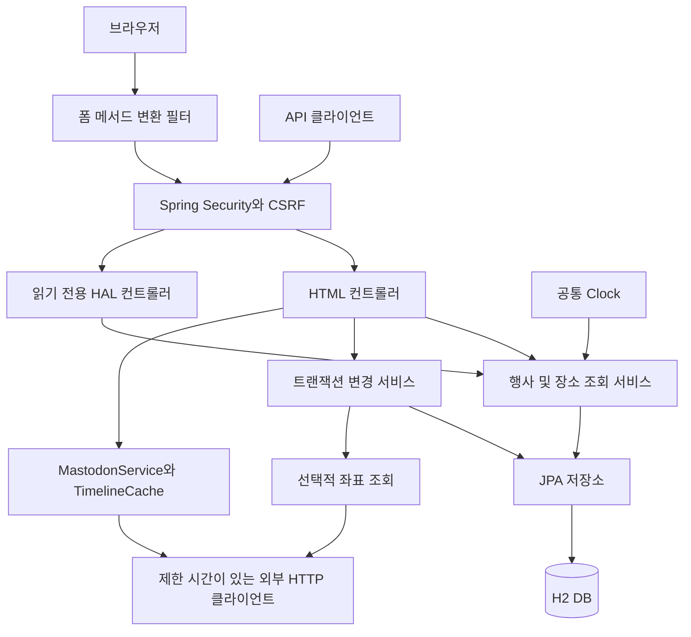

[English](ARCHITECTURE.md) | [한국어](ARCHITECTURE.ko.md)

# EventLite — 구조와 소스 코드 안내

현재 유지보수 버전의 구조를 설명합니다. 실행과 검증 명령은 [README](../README.ko.md)에, 원래 팀 과제와 개인 기여, 이전 유지보수 및 이번 강화 작업의 구분은 [포트폴리오 문서](PORTFOLIO.ko.md)에 정리했습니다.

## 요청과 데이터 흐름

방문자의 검색이나 관리자의 폼 제출이 처리되는 순서로 아래 그림을 읽으면 됩니다. **컨트롤러**가 웹 요청을 받고, **서비스**가 업무 규칙을 적용하며, **저장소**가 저장된 정보를 읽고 씁니다. **JPA**는 Java 객체와 데이터베이스 정보를 연결하는 규약이고 **Hibernate**는 그 저장 동작을 구현한 도구입니다. 여기서는 H2 데이터베이스를 사용합니다. API는 HTML 화면 대신 데이터와 이동 링크를 담은 JSON 형식인 **HAL**을 반환합니다.

Spring Security는 사용자가 어떤 작업을 수행할 수 있는지 확인합니다. **CSRF 방어**는 폼의 토큰을 검사해 다른 사이트가 로그인된 브라우저를 이용하여 원치 않는 변경 요청을 보내는 것을 막습니다. 관리자 권한을 확인하는 절차와는 별도의 검사입니다.

HTML과 HAL은 조회 서비스를 공유하고, 데이터 변경은 별도 트랜잭션 경계에서 처리합니다. 폼 메서드 변환 필터는 `POST`와 `_method=delete`로 제출한 요청을 Security 검사 전에 실제 `DELETE`로 변환합니다. 기존 삭제 폼을 유지하면서 컨트롤러가 처리할 메서드와 경로에 관리자 권한과 CSRF 검사를 적용합니다.

## 데이터 모델과 일정 규칙

`Event`는 하나의 `Venue`를 필수로 참조하고, 장소에는 여러 행사가 연결될 수 있습니다. 행사 이름, 날짜, 장소는 필수이며 시간과 설명은 선택 사항입니다. 장소는 이름, 양수 수용 인원, 주소, 우편번호와 선택적 좌표를 저장합니다. 기존 폼 검증과 DB 외래 키를 유지합니다.

행사 입력 폼은 미래 날짜를 요구합니다. 이미 저장한 행사가 오늘 날짜가 되면 예정 행사에 포함합니다. `TimeConfiguration`의 `Clock`을 화면의 날짜 모델과 일정 조회가 함께 사용하므로 테스트에서 자정, 연도 변경, 시간대 경계를 고정해 재현할 수 있습니다.

다음 행사 3개와 페이지형 일정 조회는 날짜, 시간, 이름 대소문자 무시, ID 순서로 정렬합니다. 같은 날짜에서 시간이 없으면 뒤로 보내고, 나머지 값까지 같으면 ID로 순서를 결정합니다. 인기 장소는 행사 수 내림차순, 이름 대소문자 무시, ID 순으로 정렬하며 필요한 경우 행사가 없는 장소도 포함합니다. 기존 전체 목록 진입점의 동작은 유지합니다.

## 조회 범위와 선택형 페이지 처리

조회는 저장된 정보를 요청하는 작업입니다. SQL 명령 하나가 많은 Java 객체를 읽어 들일 수도 있고, 연결된 정보를 읽다가 추가 SQL이 실행될 수도 있으므로 SQL 실행 수와 엔티티 수를 함께 살펴야 합니다. 아래의 제한 조회는 필요한 정보를 데이터베이스에서 먼저 선별한 뒤 가져옵니다. 페이지 처리도 요청한 목록 구간만 읽는 같은 원리입니다.

`EventRepository.findUpcoming`, `findUpcomingAtVenue`는 날짜 조건, 정렬, 최대 3개 제한을 DB에 적용합니다. 선택된 행사의 장소도 같은 조회에서 가져옵니다. `VenueRepository.findMostPopular`은 모든 장소의 행사 컬렉션을 로드하는 대신 DB에서 연결 관계를 집계합니다.

`findPage(query, page, size)`는 목록과 이름 검색을 처리합니다. 검색어가 null이거나 비어 있으면 전체 데이터에서 조회합니다. 검색어 앞뒤 공백을 제거하고 대소문자 없이 부분 일치시키며, `%`, `_`, `!`는 입력한 문자 자체로 검색하도록 이스케이프합니다. 페이지는 0 이상, 크기는 1부터 100까지 허용합니다.

| 요청 | 응답 |
| --- | --- |
| 페이지 인자가 없는 `/events`, `/venues`와 검색 | 기존 HTML 전체 목록 |
| `page` 또는 `size`를 지정한 HTML 목록과 검색 | DB 페이지, 전체 결과 수, 이전과 다음 이동 링크 |
| 페이지 인자가 없는 `/api/events`, `/api/venues` | 기존 읽기 전용 HAL 컬렉션 |
| `page` 또는 `size`를 지정한 API 목록 | 페이지 정보와 링크를 포함한 HAL, 선택적 `q` 검색 |
| `/venues/{id}/next3events`와 같은 API 경로 | 공통 `VenueService.findNext3Events` 결과 |

페이지 인자 중 하나만 지정하면 기본 번호는 0, 크기는 20을 사용합니다. 범위를 벗어나면 400을 반환합니다. API에는 JSON 또는 HAL `Accept` 헤더를 지정해야 합니다. 페이지 이동 링크는 공백, 한글, 퍼센트, 플러스가 포함된 검색어의 인코딩을 유지합니다.

인자가 없는 행사 전체 목록은 유지합니다. 다음 행사 조회를 개선했다고 전체 목록의 SQL 수까지 줄어든 것은 아니므로 데이터가 많으면 페이지형 조회를 선택할 수 있습니다. 변경하지 않은 조건도 [비교 기록](reports/query-comparison.json)에 포함합니다.

## 트랜잭션과 수정 충돌

`MutationService`는 생성, 수정, 삭제와 관련 검사를 하나의 트랜잭션에서 처리합니다. 저장소의 개별 작업에도 원래 트랜잭션이 있으며, 추가한 경계는 그 주변의 조회, 버전 검사, 관계 검사, 변경과 flush까지 묶기 위한 것입니다.

두 엔티티는 내부 `@Version` 카운터를 가집니다. 수정 폼은 처음 표시한 버전을 숨김 필드로 제출합니다. 버전이 없거나 현재 값과 다르면 거절하며, 명시적 검사 뒤 다른 요청이 먼저 저장한 경우에는 JPA의 버전 조건이 충돌을 감지합니다. 버전은 JSON에서 제외해 기존 API 필드를 유지합니다.

충돌하면 **409**와 설명, 최신 폼을 다시 여는 링크를 반환합니다. 이전 폼의 값을 새 레코드에 조용히 덮어쓰지 않습니다. 수정 대상이 없으면 404를 유지합니다. 생성 시에는 제출 ID와 버전을 초기화하고, 수정 시에는 URL ID와 허용된 입력 필드만 사용합니다.

행사 등록이나 장소 변경과 장소 삭제는 같은 장소 행에 비관적 쓰기 잠금을 적용합니다. 삭제는 그 트랜잭션 안에서 참조 행사가 있는지 검사합니다. 연결된 행사가 있으면 장소를 유지하고 기존 삭제 거부 메시지를 표시하며, 외래 키도 최종 관계 제약으로 유지합니다. 전체 앱이 아닌 해당 장소 행을 잠급니다.

초기 버전 파일 DB를 열면 스키마 `update`에서 Hibernate가 버전 열을 추가합니다. `VersionColumnInitializer`가 데모 초기화 전에 null 버전만 0으로 채우며, 원래 레코드 내용과 ID는 유지합니다. 브라우저 스크립트에 초기 버전 JAR를 지정하면 실제 업그레이드 후 기존 레코드 수정까지 확인할 수 있습니다.

## 선택적 외부 연동

계정 설정이 없으면 외부 서비스를 비활성화합니다. 요청에는 제한 시간이 있고 인터럽트 상태도 유지합니다. 소셜 게시 전에 행사 존재 여부와 메시지 길이를 검증하고, 게시 실패를 성공으로 표시하지 않습니다. 피드는 설정된 계정의 유효한 공개 게시물만 표시합니다.

`TimelineCache`는 단조 시간과 변경 불가능한 스냅샷을 사용합니다.

| 설정 | 기본 동작 |
| --- | --- |
| 새 응답 유지 시간 | 빈 피드를 포함한 정상 응답을 30초 동안 재사용 |
| 정상 결과의 최대 나이 | 갱신 중에는 로드 시점부터 최대 300초까지 최근 결과 재사용 |
| 갱신 실패 후 대기 | 10초 후 다시 갱신 시도 |
| 동시 갱신 | 최대 1개이며 다른 호출이 같은 요청을 중복 실행하지 않음 |
| 최초 요청 | 첫 로더는 제한 시간이 있는 외부 요청을 기다릴 수 있고, 사용할 결과가 없는 동시 호출은 빈 피드를 받을 수 있음 |

너무 오래된 결과를 계속 표시하지 않으며, 이전 스냅샷이 있을 때는 비동기로 갱신합니다. 반복 피드 조회의 대기를 줄이는 캐시이며, 최초 외부 요청 비용이나 게시 요청 시간을 없애는 기능은 아닙니다.

장소 주소를 바꾸면 새 좌표를 조회하기 전에 이전 좌표를 지웁니다. 주소가 같고 좌표가 유효하면 추가 조회를 생략합니다. 좌표가 없어도 기본 관리 기능은 사용할 수 있습니다. 지도 팝업 이름은 HTML 삽입 대신 DOM 텍스트로 표시하며, 빈 데이터, 좌표 0, 범위를 벗어난 좌표를 별도로 처리합니다.

## 실행 기반과 JSON 호환성

Java 17과 Spring Boot 4.0.8로 실행합니다. 분리된 MVC와 JPA 테스트 의존성, 갱신된 보안 요청 매처를 사용합니다. 기존 JSON 응답은 폐기 예정인 `spring-boot-jackson2` 호환 모듈로 유지합니다. 내부 버전을 제외하는 애너테이션을 포함해 Jackson 2 직렬화가 남아 있으므로 Jackson 3 전면 전환 완료로 소개하지 않습니다. 이후 호환 모듈을 제거할 때는 HAL 응답, 지도 데이터, 외부 응답 파싱을 함께 확인해야 합니다.

## 환경 설정

`.env.example`은 참고 파일이며 자동으로 읽히지 않습니다.

| 환경 변수 또는 Spring 속성 | 용도 |
| --- | --- |
| `EVENTLITE_ADMIN_USERNAME`, `EVENTLITE_ADMIN_PASSWORD` | 일반 프로필 관리자이며 두 값을 함께 지정 |
| `EVENTLITE_DATASOURCE_URL` | 기본값 `jdbc:h2:file:./db/eventlite-dev` |
| `EVENTLITE_DATASOURCE_USERNAME`, `EVENTLITE_DATASOURCE_PASSWORD` | DB 인증 |
| `EVENTLITE_DDL_AUTO` | 스키마 처리이며 일반 프로필 기본값 `update` |
| `EVENTLITE_PORT` 또는 `PORT` | HTTP 포트이며 기본값 8080 |
| `EVENTLITE_MASTODON_INSTANCE`, `EVENTLITE_MASTODON_TOKEN`, `EVENTLITE_MASTODON_ACCOUNT_ID` | 선택적 소셜 서버, 게시 인증과 피드 계정 |
| `EVENTLITE_MAPBOX_TOKEN` | 서버 좌표 조회 토큰 |
| `EVENTLITE_MAPBOX_PUBLIC_TOKEN` | 브라우저 지도 토큰 |
| `eventlite.integrations.timeout-millis` | 외부 요청 제한 시간이며 기본 3000밀리초 |
| `eventlite.mastodon.cache-ttl-millis` | 정상 피드 유지 시간이며 기본 30000밀리초 |
| `eventlite.mastodon.cache-stale-millis` | 재사용할 결과의 최대 나이이며 기본 300000밀리초 |
| `eventlite.mastodon.cache-retry-millis` | 갱신 실패 후 대기이며 기본 10000밀리초 |

일반 프로필에는 기본 관리자가 없습니다. 명시적인 `demo` 프로필은 기본적으로 별도 메모리 DB와 README의 공개 데모 계정을 사용합니다. Java 테스트는 분리된 프로필과 DB를 사용하고, 성능 및 브라우저 스크립트도 자체 DB를 지정하고 실제 외부 연동을 끕니다. 기존 파일 DB를 열 때는 원래 DB 인증 정보가 필요합니다.

서버의 좌표 조회는 좌표 저장을 위해 Mapbox의 permanent 옵션을 사용합니다. 실제 연동을 활성화하기 전에 계정의 해당 사용 권한을 확인해야 합니다. [Mapbox 저장 안내](https://docs.mapbox.com/api/search/geocoding/#storing-geocoding-results)를 참고하십시오.

## 브라우저 수명주기와 오프라인 복구

`scripts/verify-browser.mjs`는 실행 JAR와 임시 파일 DB를 사용합니다. 앱 상태와 데모 레코드를 확인한 뒤 브라우저 작업을 시작하며 Chrome도 별도 임시 프로필을 사용합니다. 종료할 때는 `StopApplication.java`가 명시적으로 활성화한 로컬 SpringApplication 관리 빈을 호출하고, 백업이나 재시작 전에 프로세스 종료를 기다립니다.

`database-snapshot.mjs`는 오프라인 확인 인자를 요구합니다. 백업은 새 스냅샷 폴더에 저장하고 원본이 변경되지 않았는지 확인한 뒤 크기와 SHA-256을 기록합니다. 복원은 매니페스트와 파일 해시를 검사하며 새 DB 기본 경로만 허용해 기존 DB를 덮어쓰지 않습니다. 복구 검증은 복원한 앱을 실행하고 API의 논리 레코드가 같은지 비교한 다음 로그인과 삭제도 확인합니다.

로컬 Attach 도구를 실행하려면 전체 JDK가 필요합니다. 일반 데모 실행에서 원격 JMX나 앱 관리 빈을 활성화하지 않습니다. 오프라인 파일 복구 검증은 운영 DB 지원이나 온라인 백업 검증을 뜻하지 않습니다.

## 소스와 검증 코드 안내

Java 패키지 기본 경로는 `src/main/java/uk/ac/man/cs/eventlite/`입니다.

| 위치 | 주요 역할 |
| --- | --- |
| `entities/Event.java`, `entities/Venue.java` | 기존 필드, 검증, 관계, 내부 버전 |
| `dao/EventRepository.java`, `dao/VenueRepository.java` | 제한된 일정 조회, 집계, DB 페이지 |
| `dao/EventServiceImpl.java`, `dao/VenueServiceImpl.java` | 조회 서비스와 좌표 처리를 포함한 장소 저장 |
| `services/EventSchedule.java`, `services/PageQuery.java` | 공통 일정 규칙과 페이지 및 검색 인자 처리 |
| `services/MutationService.java` | 원자적 변경과 수정 충돌 검사 |
| `services/TimelineCache.java`, `dao/MastodonService.java` | 제한된 피드 캐시와 소셜 연동 |
| `config/Forms.java`, `config/Security.java` | 메서드 변환 순서, 역할, CSRF, 읽기 전용 API 정책 |
| `config/TimeConfiguration.java`, `config/IntegrationViewConfig.java` | 주입 가능한 시계와 공통 화면 데이터 |
| `config/VersionColumnInitializer.java` | 업그레이드 전 DB의 null 버전 초기화 |
| `controllers/MutationConflictAdvice.java` | 내부 정보를 노출하지 않는 충돌 안내와 최신 폼 링크 |
| `src/main/resources/templates/` | 기존 관리 폼과 추가한 버전 필드 및 선택형 페이지 처리 |
| `src/main/resources/static/js/event-maps.js` | 지도 데이터 검증과 안전한 팝업 표시 |
| `scripts/` | 브라우저 검증, 오프라인 스냅샷, 통제된 성능 측정 |

`test` 프로필은 Spring 컨텍스트마다 별도 H2 메모리 DB를 생성합니다. `TestPersistenceIsolationTest`는 다른 컨텍스트를 열거나 닫아도 기존 스키마와 행이 유지되는지 확인합니다.

대표 검증 코드는 `ScheduleClockTest`, `ScheduleQueryIntegrationTest`, `MutationServiceIntegrationTest`, `FormMethodSecurityIntegrationTest`, `MutationSecurityTest`, `TimelineCacheTest`, 외부 연동 테스트, JavaScript 지도 및 스냅샷 테스트입니다. Maven `verify`는 설정한 커버리지 기준을 적용합니다. Windows와 Linux GitHub Actions 구성은 브라우저 검증과 결과 업로드도 포함합니다. 실제 실행 결과는 [2026-10-19 로컬 검증](reports/ci-repair-verification.json)과 [이전 검증 기록](reports/verification.json)에서 확인할 수 있으며, 설정 파일이 있다는 사실을 실행 성공으로 간주하지 않습니다.
