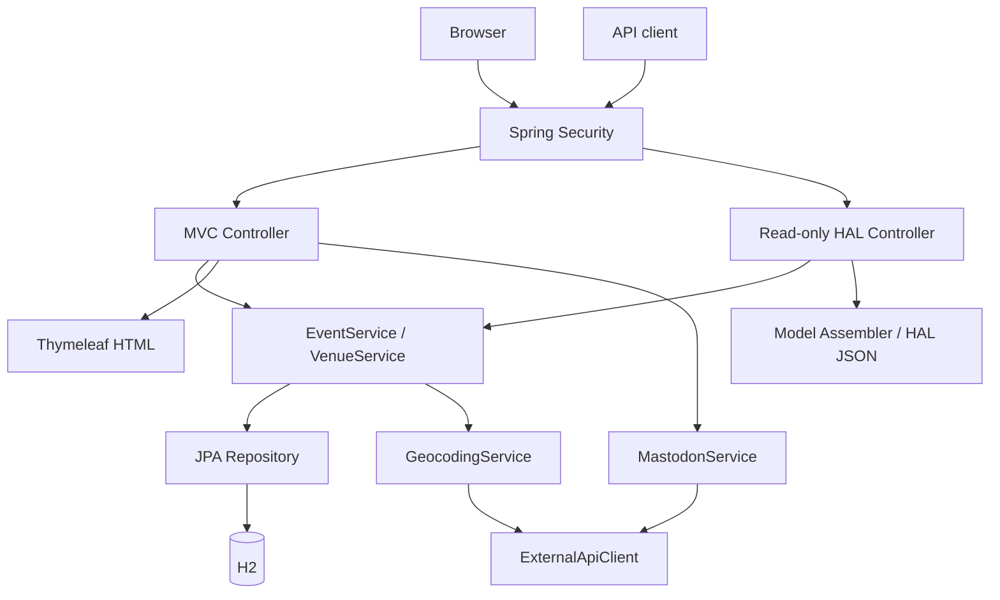

[English](ARCHITECTURE.md) | [한국어](ARCHITECTURE.ko.md)

# EventLite — Architecture and Source Guide

This document describes the current maintenance version. See the [portfolio document](PORTFOLIO.md) for project timing and individual contribution, and the [README](../README.md) for run commands and a summary of verification results.

## Request and Data Flow

The security filter distinguishes public queries from changes by administrators. HTML pages and the JSON API use the same event and venue services, while each controller handles its response format. External map and social requests use a separate HTTP adapter.

## Source Folder Guide

The Java package base is `src/main/java/uk/ac/man/cs/eventlite/`.

| Location | Responsibilities and files to read first |
| --- | --- |
| `entities/` | `Event.java`, `Venue.java`: event and venue fields, input constraints, and JPA relationships |
| `controllers/` | `EventsController`, `VenuesController`, `HomeController`: HTML queries and form handling |
| `controllers/*ControllerApi` | Public queries and HAL responses for events and venues |
| `controllers/ApiController.java` | Entry point for `/api` queries |
| `dao/` | Event and venue services and JPA repositories; also contains the social adapter `MastodonService` |
| `assemblers/` | HAL model construction that adds query links to entities |
| `config/Security.java` | Public routes, administrator roles, CSRF, authentication, and logout settings |
| `config/IntegrationViewConfig.java` | Public map token, integration availability, and shared date model |
| `config/data/InitialDataLoader.java` | Initial data creation for the `demo` profile |
| `services/` | `GeocodingService`, `Coordinates`, and the HTTP client with time limits |
| `src/main/resources/templates/` | Shared layout and event, venue, and login pages |
| `src/main/resources/static/js/event-maps.js` | Map display conditions, coordinate validation, and popup creation |
| `src/main/resources/application*.properties` | Normal and demo environment settings |
| `src/test/java/` | Service, MVC, API, security, and external adapter tests, plus test database configuration |
| `src/test/javascript/event-maps.test.cjs` | JavaScript regression tests for map logic |
| `docs/images/`, `docs/verification.json` | Screenshots and result records from maintenance verification |

## Data Model and Scheduling Rules

Each event is associated with one venue, and a venue can have multiple events. An event has a name, a date, and optional time and description fields. A venue stores its name, capacity, road address, postcode, and optional latitude and longitude.

Creation and update forms validate required values, lengths, and dates. They also check that the selected venue exists; the database foreign key for an event's venue does not allow null. A request to delete a venue with associated events is rejected with an explanatory message.

Event forms require a future date. When an already stored event reaches the current day, it remains upcoming, so the upcoming list **includes today**. The next three events are sorted by date, time, and name, with events that have no time placed last within the same date. Popular venues are sorted by the number of associated events and return up to three entries according to the actual dataset size.

## Key Design Decisions

### Separate Public Queries from Administrator Changes

Lists, search, details, and API queries are public. HTML management forms and actual creation, update, deletion, and social posting requests require the `ADMINISTRATOR` role. CSRF checks remain enabled for requests that change data. Undefined access and the H2 console are denied.

The interface also shows management controls to administrators, while server authorization protects change requests. Hiding buttons alone does not control change permissions.

### An Explicitly Read-Only API

JPA repositories are not automatically exposed through REST. Explicit API controllers query events, venues, and their relationships, and model assemblers build links. API writes are not allowed even for administrators; changes go through the validated web management flow.

### URL IDs and Allowed Input Fields

An update request loads the existing target using the URL ID, then changes only allowed fields. A form ID that differs from the URL does not update a different target, and a missing target returns 404. Creation ignores a submitted ID and creates a new record.

### The Relationship Between Addresses and Coordinates

Changing an address removes the coordinates for its previous address. If new coordinates cannot be obtained, the old location is not displayed as the location of the new address. An unchanged address with valid coordinates skips an additional geocoding request. Core event and venue features remain usable without coordinates.

### Optional External Services

Without external account settings, integrations are disabled and the interface displays guidance. HTTP requests have time limits, and requests in progress are cancelled on timeout or interruption. Adapter tests use simulated responses rather than real accounts.

The Mastodon feed displays only public posts from the configured account. Posting checks event existence and input before sending the request, and a failed post is not reported as successful. Browser map tokens and server geocoding tokens use separate settings.

Map popups display stored event and venue names through `textContent`. Empty results do not trigger invalid map bounds calculations; zero coordinates are treated as valid, and out-of-range coordinates are excluded.

## Environment Configuration

`.env.example` documents the available settings. Spring Boot does not load it automatically, so set variables in the shell or execution environment.

| Environment variable | Purpose |
| --- | --- |
| `EVENTLITE_ADMIN_USERNAME`, `EVENTLITE_ADMIN_PASSWORD` | Administrator authentication for the normal profile |
| `EVENTLITE_DATASOURCE_URL` | Defaults to `jdbc:h2:file:./db/eventlite-dev` |
| `EVENTLITE_DATASOURCE_USERNAME`, `EVENTLITE_DATASOURCE_PASSWORD` | File database authentication |
| `EVENTLITE_DDL_AUTO` | JPA schema handling; defaults to `update` in the normal profile |
| `EVENTLITE_MASTODON_INSTANCE` | Mastodon instance HTTPS URL |
| `EVENTLITE_MASTODON_TOKEN`, `EVENTLITE_MASTODON_ACCOUNT_ID` | Posting authorization and the account used for the public feed |
| `EVENTLITE_MAPBOX_TOKEN` | Server geocoding token |
| `EVENTLITE_MAPBOX_PUBLIC_TOKEN` | Public `pk.` token for the browser |
| `EVENTLITE_PORT` or `PORT` | Server port; defaults to `8080` |

The normal profile has no default administrator account. Configuring both an administrator name and password creates an account with a BCrypt-encoded password for authentication. Opening an existing file database requires its own authentication settings.

| Profile | Data and accounts |
| --- | --- |
| Normal | File database and administrator account configured through environment variables; no demo data creation |
| `demo` | Separate in-memory database, an explicitly created demo account, and external integrations disabled by default |
| `test` | Dedicated in-memory test database and authentication settings; no calls to external accounts |

The `demo` profile uses `create-drop`, so its data does not survive shutdown. Initial data uses relative dates. If venues already exist but events do not, initialization links events to stored venues; if events already exist, it does not create duplicates.

Server geocoding currently uses Mapbox v6 with `permanent=true` because coordinates are stored in the database. Check the account's permanent geocoding settings before enabling the real integration. See the [official Mapbox explanation](https://docs.mapbox.com/api/search/geocoding/#storing-geocoding-results).

## Finding Verification Code

| Condition to check | Representative tests |
| --- | --- |
| Actual HTTP authorization and CSRF | `MutationSecurityTest`, `SecurityIntegrationTest`, `SecurityConfigurationTest` |
| Read-only API policy | `ReadOnlyApiIntegrationTest` and API controller tests |
| HTML forms and CRUD flows | `EventsControllerTest`, `VenuesControllerTest`, and their integration tests |
| Small venue datasets, coordinates, and the next three events | `VenueServiceRegressionTest`, `EventServiceImplTest` |
| Partial database initialization and repeated execution | `InitialDataLoaderTest` |
| External HTTP, posting, and geocoding failures | `ExternalApiClientTest`, `MastodonServiceTest`, `GeocodingServiceTest` |
| Map dates, coordinates, popups, and initialization failures | `src/test/javascript/event-maps.test.cjs` |

Current verification figures and execution limits are recorded in the [portfolio document](PORTFOLIO.md#maintenance-verification). After application code changes, run both verification commands in the [README](../README.md) to check Java and map logic together.
