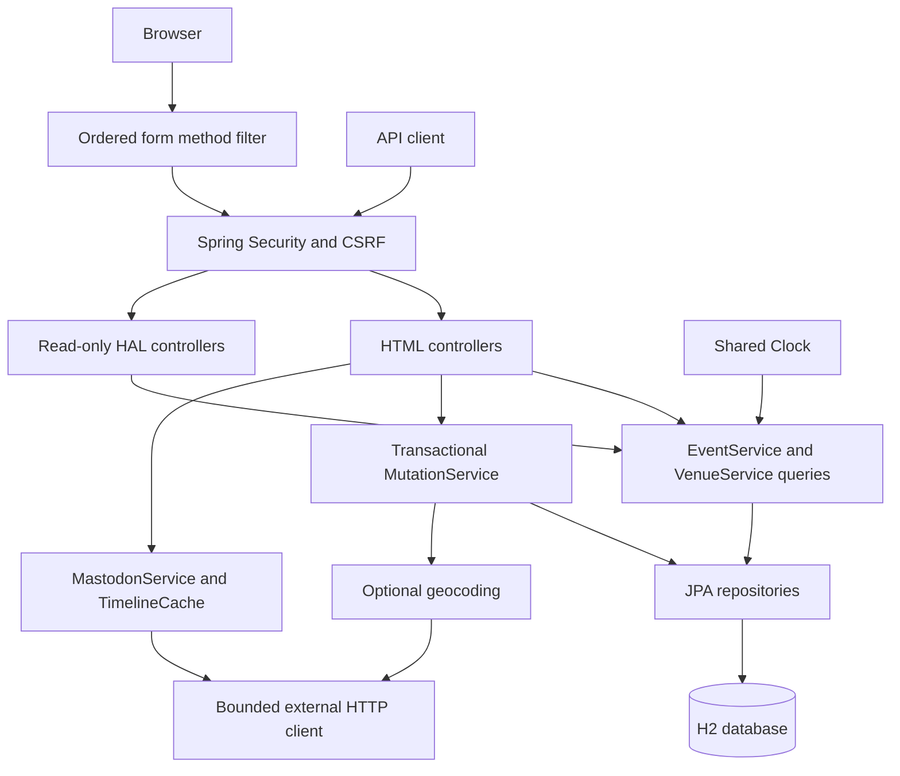

[English](ARCHITECTURE.md) | [한국어](ARCHITECTURE.ko.md)

# EventLite — Architecture and Source Guide

This guide describes the maintained application. [The README](../README.md) provides run and verification commands. [The portfolio document](PORTFOLIO.md) separates the original team work, individual contribution, historical maintenance, and subsequent strengthening.

## Request and data flow

HTML pages and HAL responses share query services. Data changes use a separate transactional boundary. The ordered form filter turns the rendered `POST` plus `_method=delete` into the effective `DELETE` before security evaluates its method and route. This preserves the existing browser forms while applying administrator authorization and CSRF checks to the request actually handled by the controller.

## Data model and schedule rules

An `Event` belongs to one non-null `Venue`; a venue can have multiple events. Event names, dates, and venues are required. Time and description are optional. Venue records include a name, positive capacity, address, postcode, and optional coordinates. The existing form validation and database foreign key remain in place.

Event forms require a future date. Stored events on the current day are still upcoming. `TimeConfiguration` supplies a `Clock` used by the request date model and schedule queries. Tests can fix that clock to reproduce midnight, year changes, and time-zone boundaries.

The next-three and paged schedule queries order by date, time, case-insensitive name, and ID. Null times come last for the same date. ID resolves remaining ties deterministically. Popular venues order by event count descending, then case-insensitive name and ID, and include venues with zero events when the dataset requires them. Original full-list entry points retain their existing behavior.

## Query boundaries and optional pagination

`EventRepository.findUpcoming` and `findUpcomingAtVenue` apply the date condition, ordering, and three-row limit in the database. They fetch each selected event's venue in the same query. `VenueRepository.findMostPopular` counts relationships in the database rather than loading every venue's complete event collection.

`findPage(query, page, size)` supports lists and name searches. A null or blank query means the full dataset. Search terms are trimmed and matched without case sensitivity; `%`, `_`, and `!` are escaped so the supplied characters remain literal. The page must be zero or greater, and its size must be 1 through 100.

| Request | Response behavior |
| --- | --- |
| `/events`, `/venues`, and their searches without page arguments | Original HTML full lists |
| HTML list or search with `page` or `size` | Database page, result count, and previous/next navigation |
| `/api/events` and `/api/venues` without page arguments | Original read-only HAL collections |
| API collection with `page` or `size` | Paged HAL with metadata and navigation; optional `q` search |
| `/venues/{id}/next3events` and API equivalent | Shared `VenueService.findNext3Events` result |

The default page number is zero and size is 20 when the other page argument is supplied. Invalid bounds return 400. API clients should send a JSON or HAL `Accept` header. Pagination links preserve the request's encoded search terms, including spaces, Korean text, percent signs, and plus signs.

The no-parameter full-event list is deliberately retained. Its SQL count is not improved by the next-three changes; large datasets should use optional pagination. Measurements and unchanged cases are available in [the comparison report](reports/query-comparison.json).

## Transactional mutations and conflict handling

`MutationService` groups each create, update, or delete operation and its checks within a transaction. The repositories already provide their own transactional operations; the additional boundary keeps the surrounding lookup, version check, relationship check, mutation, and flush together.

Both entities have an internal `@Version` counter. Update forms carry the version originally displayed in a hidden field. A missing or mismatched version is rejected, and JPA's version predicate detects a competing commit after the explicit check. The version field is excluded from JSON, preserving the existing API fields.

A conflict returns **409** with an explanation and a link to reload the latest form. Submitted values are not silently applied to the newer record. A missing update target remains 404. Creation resets submitted IDs and versions; an update uses the URL ID and only the allowed form fields.

Event insertion or venue reassignment and venue deletion acquire a pessimistic write lock on the same venue row. Deletion checks for referenced events within that transaction. A linked venue is retained and the existing explanatory message is displayed. The foreign key remains the final relationship constraint. These are targeted row locks, not a global application lock.

When opening a pre-upgrade file database, Hibernate adds the version columns under schema `update`. `VersionColumnInitializer` runs before demo initialization and fills only null version counters with zero. Existing record content and IDs are retained. The browser verifier can test that upgrade with an initial-version JAR and then edit the migrated records.

## Optional external services

External services remain disabled without their account settings. Requests have bounded timeouts; interruption is preserved. An event's existence and message length are checked before a social post. Failed posting does not appear successful. The feed contains only valid public posts from the configured account.

`TimelineCache` uses elapsed monotonic time and immutable snapshots:

| Setting | Default behavior |
| --- | --- |
| Fresh duration | Reuse a successful response, including an empty feed, for 30 seconds |
| Maximum successful-result age | Return a recent result while refreshing, up to 300 seconds from its load time |
| Failed refresh backoff | Wait 10 seconds before another refresh attempt |
| Concurrent refreshes | At most one; other callers do not duplicate the request |
| Cold request | The first loader can wait for one bounded request; callers without a usable result can receive an empty feed |

Expired results are not displayed indefinitely. Refresh happens asynchronously when an older snapshot exists. The cache improves repeat feed reads; it does not remove the cold external-request cost or accelerate posting.

Changing a venue address clears the previous coordinates before a new geocoding attempt. An unchanged address with valid coordinates skips that lookup. Missing coordinates do not prevent core management. Map popup names use DOM text rather than HTML insertion; empty data, zero coordinates, and invalid coordinates are handled explicitly.

## Runtime and JSON compatibility

The application runs on Java 17 and Spring Boot 4.0.8. Modular MVC and JPA test dependencies and the updated security matcher configuration are used. Existing JSON behavior is retained through the deprecated `spring-boot-jackson2` compatibility module. Jackson 2 annotations and serializers remain in use, including the exclusion of internal version fields. This is not a completed Jackson 3 migration. Removing the bridge later requires checking HAL responses, map payloads, and external response parsing together.

## Environment configuration

`.env.example` is a reference, not an automatically loaded file.

| Variable or Spring property | Purpose |
| --- | --- |
| `EVENTLITE_ADMIN_USERNAME`, `EVENTLITE_ADMIN_PASSWORD` | Normal-profile administrator; both are required together |
| `EVENTLITE_DATASOURCE_URL` | Defaults to `jdbc:h2:file:./db/eventlite-dev` |
| `EVENTLITE_DATASOURCE_USERNAME`, `EVENTLITE_DATASOURCE_PASSWORD` | Database authentication |
| `EVENTLITE_DDL_AUTO` | Schema handling; normal default is `update` |
| `EVENTLITE_PORT` or `PORT` | HTTP port; default is 8080 |
| `EVENTLITE_MASTODON_INSTANCE`, `EVENTLITE_MASTODON_TOKEN`, `EVENTLITE_MASTODON_ACCOUNT_ID` | Optional social instance, posting authorization, and feed account |
| `EVENTLITE_MAPBOX_TOKEN` | Server geocoding token |
| `EVENTLITE_MAPBOX_PUBLIC_TOKEN` | Browser map token |
| `eventlite.integrations.timeout-millis` | External request timeout; default 3000 milliseconds |
| `eventlite.mastodon.cache-ttl-millis` | Fresh feed duration; default 30000 |
| `eventlite.mastodon.cache-stale-millis` | Maximum reusable result age; default 300000 |
| `eventlite.mastodon.cache-retry-millis` | Failure backoff; default 10000 |

The normal profile creates no default administrator. The explicit `demo` profile uses an isolated in-memory database by default and the public demo credentials described in the README. Java tests use isolated profiles and databases; benchmark and browser scripts explicitly select their own databases and disable real integrations. An existing file database still requires its original database credentials.

Server geocoding stores coordinates and uses Mapbox's permanent-geocoding option. Account permissions must support that use before enabling it. See [Mapbox's storage documentation](https://docs.mapbox.com/api/search/geocoding/#storing-geocoding-results).

## Browser lifecycle and offline recovery

`scripts/verify-browser.mjs` runs the executable JAR against a temporary file database. It checks health and waits for demo records before browser actions. Chrome uses a separate temporary profile. Normal shutdown invokes the explicitly enabled local SpringApplication admin bean through `StopApplication.java`, then waits for the process to exit before backup or restart.

`database-snapshot.mjs` requires an explicit offline confirmation. Backup creates a new snapshot directory, checks that the source file has not changed, and records the bytes and SHA-256. Restore checks the manifest and file hash and requires a new database base path. It never overwrites an existing database. Recovery verification starts the restored application and compares logical records through the API, then checks login and deletion.

The script requires a full JDK for the local attach helper. It does not enable remote JMX or the application admin bean in ordinary demo commands. Offline file recovery does not establish production database support or online backup.

## Source and verification map

The Java package root is `src/main/java/uk/ac/man/cs/eventlite/`.

| Location | Main responsibility |
| --- | --- |
| `entities/Event.java`, `entities/Venue.java` | Existing fields, validation, relationship, internal version |
| `dao/EventRepository.java`, `dao/VenueRepository.java` | Limited schedule queries, aggregation, and database pages |
| `dao/EventServiceImpl.java`, `dao/VenueServiceImpl.java` | Query services and geocoding-aware venue saving |
| `services/EventSchedule.java`, `services/PageQuery.java` | Shared schedule rules and safe page/search parameters |
| `services/MutationService.java` | Atomic mutations and conflict checks |
| `services/TimelineCache.java`, `dao/MastodonService.java` | Bounded feed cache and social adapter |
| `config/Forms.java`, `config/Security.java` | Effective method ordering, roles, CSRF, and read-only API policy |
| `config/TimeConfiguration.java`, `config/IntegrationViewConfig.java` | Injectable clock and shared view data |
| `config/VersionColumnInitializer.java` | Null version backfill for pre-upgrade databases |
| `controllers/MutationConflictAdvice.java` | Safe conflict feedback and latest-form link |
| `src/main/resources/templates/` | Original management forms plus version fields and optional pagination |
| `src/main/resources/static/js/event-maps.js` | Map data validation and safe popup rendering |
| `scripts/` | Browser verification, offline snapshots, and controlled benchmarks |

The `test` profile creates a separate H2 memory database for each Spring context. `TestPersistenceIsolationTest` verifies that opening or closing another context preserves existing schemas and rows.

Representative tests include `ScheduleClockTest`, `ScheduleQueryIntegrationTest`, `MutationServiceIntegrationTest`, `FormMethodSecurityIntegrationTest`, `MutationSecurityTest`, `TimelineCacheTest`, external-adapter tests, and the JavaScript map/snapshot suites. Maven `verify` enforces the configured coverage gates. The Windows/Linux GitHub Actions matrix also runs browser verification and uploads generated reports. Consult [the 2026-10-19 local verification](reports/ci-repair-verification.json) and [earlier verification record](reports/verification.json) for actual executions; a workflow definition alone is not an execution result.
